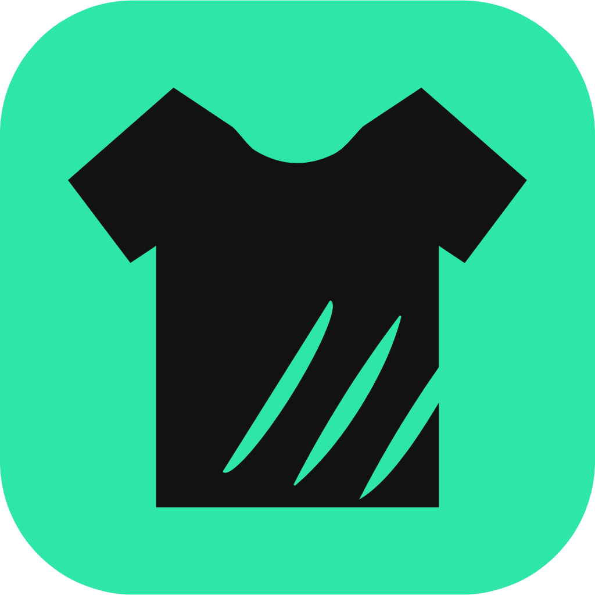
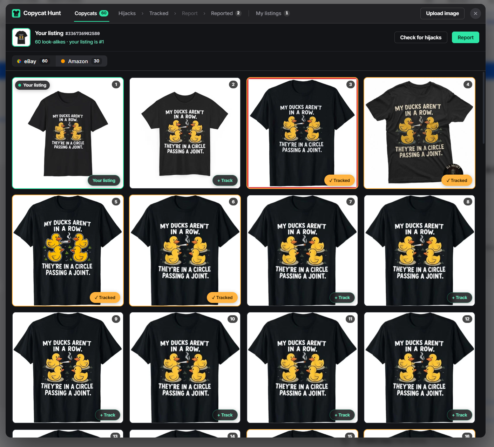
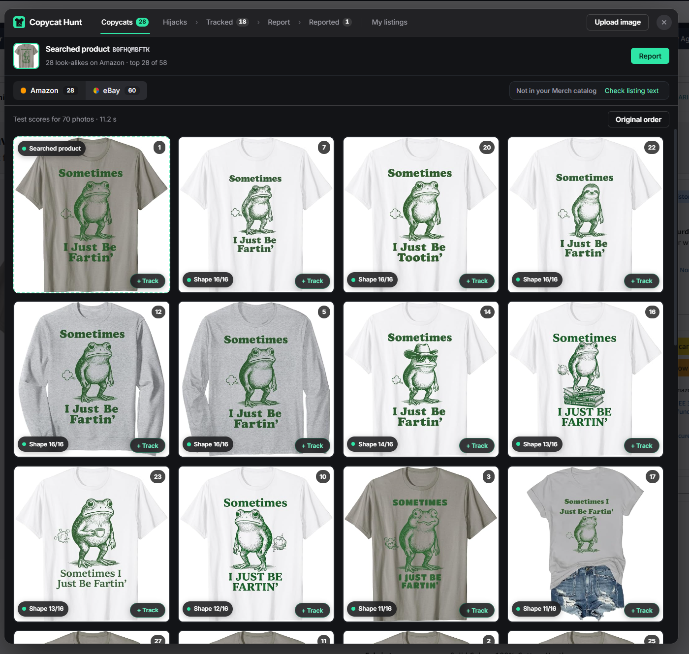

<p align="center"></p>

<h1 align="center">Copycat Hunt</h1>

<p align="center">
  
  
  
  
</p>
<p align="center">
  
  
  
  
</p>

<p align="center"><b>Finds copies of your T-shirt designs on Amazon and eBay, groups them by design, and fills the report forms for you.</b><br/>
For print-on-demand sellers on Amazon Merch on Demand, eBay and Etsy.</p>

<p align="center"></p>

## 🎯 The problem

Print-on-demand sellers (Amazon Merch on Demand, eBay, Etsy) live from their
designs. When a design starts to sell, copies appear within days: the same
art re-uploaded, traced with a hat added, or redrawn with the same elements.
Finding them means searching the marketplaces by hand, one design at a time,
and every copy then needs a separate infringement report with the same
details typed again. A seller with a few hundred designs can't keep up, and
the copies take the sales.

## ✨ What it does

- **Hunt by image.** On any Amazon or eBay product page, or from an image you
  drop or upload, one click searches Amazon's look-alike search and eBay's
  image search together and shows the results side by side.
- **Knows your own listings.** It syncs your Merch on Demand catalog and your
  eBay Seller Hub listings into a local database, so your own products are
  never flagged as copies.
- **Track copies by design.** Copies are grouped under the design they copy,
  with their first-available dates next to yours.
- **Listing hijack check.** Finds listings that hijacked your title, brand or
  bullet points, even with a different design.
- **Fill the report forms.** Opens Amazon's and eBay's infringement forms and
  fills them with your details, the copies and a plain description ("Copied
  design", "Copied with changes", "Stolen artwork", "Copied listing"). It never
  ticks the legal declaration boxes and never presses Submit; you check and
  send it yourself.
- **Image scorer (beta).** A server-side scorer measures how much of your
  drawing appears in each result ("Art 15/16 · Text 8/8"), so real copies
  rise to the top.

  
- **Fix problems.** One button in the toolbar menu restarts stuck syncs,
  clears eBay pauses, checks the local database and the license, and says what
  it did.

## ⚙️ How it works

Three parts: the **extension** (everything on your computer), an **API
Worker** on Cloudflare (license check, listing hijack check, access to the
scorer) and the **scorer** on Google Cloud Run (image comparison). Diagram and
data flow: [docs/architecture.md](docs/architecture.md).

| Part | Built with |
|---|---|
| Extension | JavaScript (Manifest V3, no framework), SQLite WASM in an offscreen document (OPFS storage), GSAP for small animations |
| API | Cloudflare Workers (JavaScript), Web Crypto (Ed25519 signature checks, RS256 for Google tokens) |
| Scorer | Python 3.12, FastAPI, OpenCV, NumPy, Pillow; Docker on Google Cloud Run |
| Licensing | Keygen (signed license answers, checked with a pinned public key) |

### ☁️ Hosting

| Service | What runs there | How it's protected |
|---|---|---|
| **Cloudflare Workers** | `copycat-hunt-api`: license check, listing hijack check, access to the scorer. Deployed with `wrangler`. | Every request needs a fresh, signed license answer; per-license rate limits. Its one secret (the Google key) is an encrypted Cloudflare secret. |
| **Google Cloud Run** (europe-west1) | `copycat-vision`: the image scorer, built by Google Cloud Build from the `Dockerfile` and stored in Artifact Registry. Scales to zero when idle, at most 2 instances. | No public access: without a Google identity token the answer is 403. Only the Worker's service account may call it. A budget alert watches the cost. |
| **Keygen** | License keys and their signed validation answers. | The extension and the Worker only hold the public key. |

## 🚀 Run it locally

**Extension**: works in **Google Chrome, Microsoft Edge and Brave** (any
Chromium browser, version 116 or newer).

1. Open the extensions page: `chrome://extensions`, `edge://extensions` or
   `brave://extensions`, and turn on **Developer mode**.
2. Click **Load unpacked** and choose the `extension/` folder.
3. Open any Amazon or eBay product page: the Copycat Hunt button appears at
   the bottom right. First use opens a short setup page.

> **Accounts you need:** an active **Merch by Amazon** account is required:
> the setup syncs your Merch catalog so your own designs are never flagged.
> An **eBay** account isn't needed to search eBay; you only need one to send
> eBay reports (and to sync your own eBay listings if you sell there).

**API Worker** (Node 20+):

```bash
cd server/api
npx wrangler dev        # local server on http://localhost:8787
```

Details, endpoints and deployment: [server/api/README.md](server/api/README.md).

**Scorer** (Python 3.12):

```bash
cd server/scorer
python -m venv .venv
.venv/Scripts/pip install -r requirements.txt      # Linux/macOS: .venv/bin/pip
.venv/Scripts/python -m uvicorn app.main:app --port 8765
curl http://127.0.0.1:8765/v1/health
```

Details and the Cloud Run deploy command: [server/scorer/README.md](server/scorer/README.md).

> **Server accounts:** running the Worker and the scorer on your own computer needs
> no account. Deploying them needs your own **Cloudflare** account and your
> own **Google Cloud** project; for the Worker to reach your scorer, give it
> your own Google service-account key as a Worker secret (`GCP_SA_KEY`).

## 📁 Repository

| Folder | What's inside |
|---|---|
| [`extension/`](extension) | The browser extension, exactly as packaged for the Chrome Web Store |
| [`server/api/`](server/api) | Cloudflare Worker: license check, listing hijack check, scorer access |
| [`server/scorer/`](server/scorer) | Image scorer: FastAPI app for Google Cloud Run |
| [`docs/`](docs) | Architecture diagram and screenshots |
| [`brand/`](brand) | Logo, store icon, privacy policy |

Inside `extension/`:

| File | What it does |
|---|---|
| `manifest.json` | Permissions, scripts, minimum browser version (116) |
| `content.js`, `content.css` | Everything on the Amazon/eBay page: hunt window, tabs, report forms |
| `background.js` | Service worker: message router, Amazon search, eBay request queue, syncs, licensing |
| `amazon-report-core.js`, `amazon-report-fill.js` | Amazon report rules and the form filler |
| `merch-*.js`, `ebay-*.js` | Sync of your own Merch and eBay listings |
| `catalog-*.js`, `db-worker.js`, `offscreen.*` | Local SQLite database |
| `license-*.js` | License checks (signature verification, storage) |
| `popup.*`, `setup.*` | Toolbar menu and first-setup page |
| `vendor/` | GSAP and the official SQLite WASM build |

## 📊 Status

✅ **Works today:** image hunts on Amazon and eBay, own-listing recognition
(Merch and eBay sync), tracking by design, the listing hijack check, Amazon
and eBay report forms, licensing, "Fix problems". The extension is at version
3.27.1.

🧪 **In beta:**

- The image scorer shows raw signals, not a "copy probability". Its
  thresholds aren't calibrated yet. It is hidden behind a test switch while
  labelled data is being collected.
- I measured it on 499 shirts I labelled by hand (143 copies). The outline
  scorer works well when the design is a Merch art file, but it misses redraws
  and many eBay photos. A second signal based on an image-understanding model
  (CLIP + DINOv2) caught most of those; it is measured but not shipped yet.
- Known misses: a design printed very small in the photo, and a different
  character placed on the same body (it is treated as a copy).

🛣️ **Not done yet:**

- Publication on the Chrome Web Store.
- An automatic "probable copy" verdict.
- A fully automatic mode: scheduled searches that run on their own and
  prepare draft reports, which wait for your OK before anything is sent.

## 🔒 Privacy and security

- No secrets in this repository. The extension contains only Keygen's
  **public** key; license answers are verified by their signature.
- The scorer has no public address. The Worker reaches it with a Google key
  stored as an encrypted Cloudflare secret, and that key can only call the
  scorer.
- Nothing personal is collected from Amazon or eBay pages. Tracked copies and
  your own listings stay on your computer.
- The extension never submits a report and never ticks a declaration box for
  you, and it stops if Amazon or eBay asks for a robot check.

## 🗓️ Built before and during the programme

The project started in **August 2026**, before the programme, as a small eBay
helper: item-number badges on eBay listings and an eBay image search for
copies.

During the programme (**4 September to October 2026**) I built most of what
is here: Amazon support (look-alike search, product details, the Amazon
report form), the licensing system and the API Worker, the local SQLite
catalog with Merch and eBay sync, tracking by design, the report flows for
both marketplaces, the redesigned interface, the image scorer on Google Cloud
Run, the hand-labelled test set and its measurement, and "Fix problems".

🎨 **UI/UX.** I redesigned the interface from scratch: one window with tabs
(Copycats, Hijacks, Tracked, Report, Reported, My listings) instead of
separate pop-ups, a plainer and more readable look applied the same way across
the whole tool, clear messages instead of error codes, and a layout that stays
clear of the Windows taskbar.

💰 **From testers to customers.** After the week-two session on how money moves,
I went back to the sellers who had tested the tool, and 3 of them became
paying subscribers.

## 👤 Built by

**HOUCINE BENSLIMANE**: designed and built the whole product: the extension's
UI/UX, Amazon and eBay hunts, report-form filling and local database; the
Cloudflare API and licensing; the image scorer on Google Cloud Run;
deployment, testing, and testing with sellers.

AI tools used:

- **Claude Code** (Anthropic), the main one: a pair programmer throughout,
  for writing and reviewing code, tests and the scorer.
- **ChatGPT** (OpenAI) and **Manus**: research, ideas and drafting.
