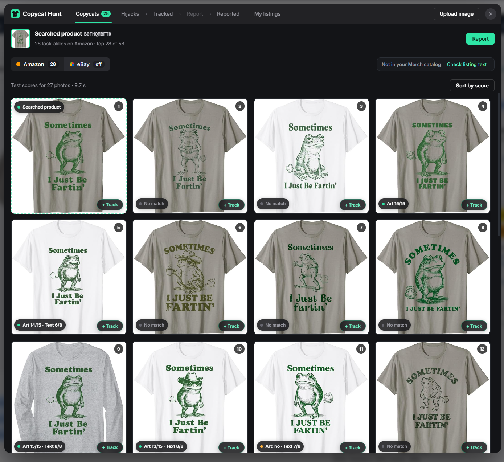
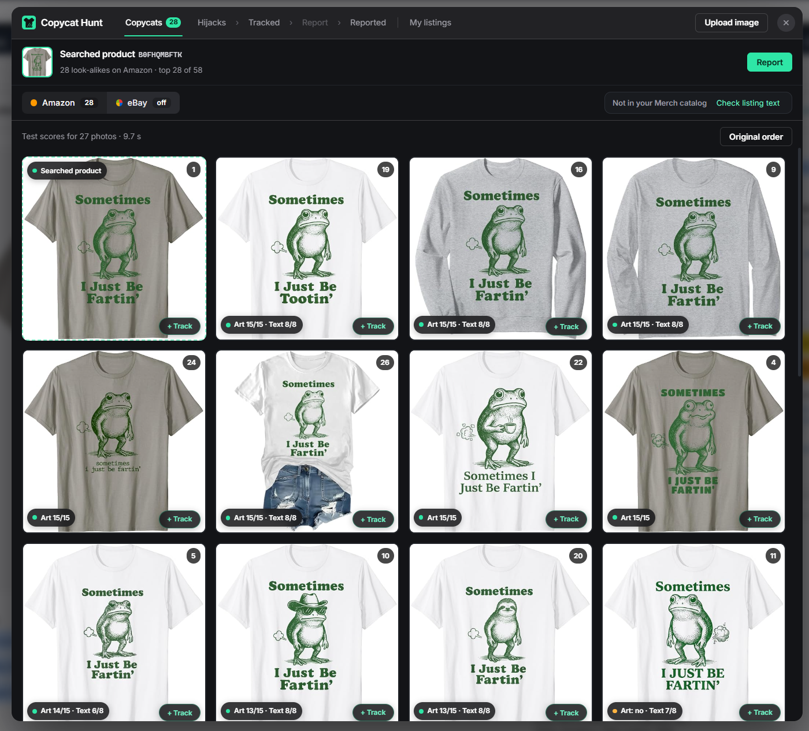

<p align="center"></p>

<h1 align="center">Copycat Hunt</h1>

<p align="center">
  
  
  
  
</p>
<p align="center">
  
  
  
  
  
</p>

<p align="center">
  <a href="https://chromewebstore.google.com/detail/copycat-hunt/lpipaodhlgeakmanmlmgjhicbhbnhklk"></a>
</p>

<p align="center"><b>Finds copies of your T-shirt designs on Amazon and eBay, groups them by design, and fills the report forms for you.</b><br/>
For print-on-demand sellers on Amazon Merch on Demand, eBay & Soon Etsy.</p>

<p align="center"></p>

## 🎯 The problem

Print-on-demand sellers (Amazon Merch on Demand, eBay, & soon Etsy) live from their
designs. When a design starts to sell, copies appear within days: the same
art re-uploaded, traced with a hat added, or redrawn with the same elements.
Finding them means searching the marketplaces by hand, one design at a time,
and every copy then needs a separate infringement report with the same
details typed again. A seller with a few hundred designs can't keep up, and
the copies take the sales.

## ✨ What it does

- **Hunt by image.** On any Amazon or eBay product page, or from an image you
  drop or upload, one click searches Amazon's look-alike search and eBay's
  image search together and shows the results side by side. It loads **all**
  of Amazon's look-alikes, not only the first page.
- **Amazon in six countries.** Hunts and tracking work on amazon.com,
  .co.uk, .de, .fr, .it and .es: a hunt searches the Amazon site you are on,
  and each copy remembers its marketplace. Reports are filled on amazon.com
  for now.
- **Knows your own listings.** It syncs your Merch on Demand catalog and your
  eBay Seller Hub listings into a local database, so your own products are
  never flagged as copies.
- **Best sellers.** Your own designs ranked by units sold (7, 30 or 90 days,
  or 12 months, per marketplace), read from your Merch sales report during the
  product sync. Copycats go after what sells, so each design shows when it was
  last hunted and starts a hunt in one click. Units only: no money amounts are
  read or saved.
- **Look-alikes first, copycats when you say so.** A hunt shows look-alikes;
  the ones you mark with **Copycat** move to the Copycats tab, grouped under
  the design they copy,
  with their first-available dates next to yours. Each copy keeps its reason
  ("Copied design", "Copied with changes"...), so one report covers all the
  copies with the same reason.
- **Listing hijack check.** Finds listings that copied your title, brand or
  bullet points word for word, even with a different design.
- **Fill the report forms.** Opens Amazon's (all six countries, each copy
  reported on its own site) and eBay's infringement forms and fills them with your details, the copies and a plain description ("Copied
  design", "Copied with changes", "Stolen artwork", "Copied listing"). It never
  ticks the legal declaration boxes and never presses Submit; you check and
  send it yourself.
- **Messages from Copycat Hunt.** Announcements, maintenance notices and
  price changes, written on a private admin page: an unread count on the
  toolbar icon, the list in the menu, and a new message opens once in the
  middle of the Amazon, eBay or Merch page.
- **Image scorer (beta).** A server-side scorer compares your art with each
  result and **Sort by score** puts the real copies first and hides the ones
  that don't look like yours. It matches the printed art only, never the shirt
  mockup around it, and a second signal (two image models) catches redraws
  that share no lines.

  | Similar subjects / styles | Sorted by score |
  |---|---|
  |  |  |
  | Close copies are scattered between other frog designs. | The closest copies come first. |
- **Buy a license in the extension.** The toolbar menu and the setup page show
  the plans (monthly or yearly). Payment runs on Stripe Checkout; the key is
  shown on a thank-you page and sent by email, and renewals and cancellations
  update the license automatically.
- **Light and dark mode**, with your own icons and type, applied the same way
  across the whole tool.
- **Fix problems.** One button in the toolbar menu restarts stuck syncs,
  clears eBay pauses, checks the local database and the license, and says what
  it did.

## ⚙️ How it works

Three parts: the **extension** (everything on your computer), an **API
Worker** on Cloudflare (license check, listing hijack check, buying a license,
access to the scorer) and the **scorer** on Google Cloud Run (image
comparison). Diagram and data flow: [docs/architecture.md](docs/architecture.md).

| Part | Built with |
|---|---|
| Extension | JavaScript (Manifest V3, no framework), SQLite WASM in an offscreen document (OPFS storage), GSAP for small animations, IBM Plex type, Flaticon UIcons |
| API | Cloudflare Workers (JavaScript), Web Crypto (Ed25519 signature checks, RS256 for Google tokens, HMAC for Stripe webhooks) |
| Scorer | Python 3.12, FastAPI, OpenCV, NumPy, Pillow, ONNX Runtime (CLIP ViT-B/32 and DINOv2-small, 8-bit); Docker on Google Cloud Run |
| Licensing and payments | Keygen (signed license answers, checked with a pinned public key), Stripe Checkout and webhooks, Resend for the key email |

### ☁️ Hosting

| Service | What runs there | How it's protected |
|---|---|---|
| **Cloudflare Workers** | `copycat-hunt-api` on api.copycathunt.com: license check, listing hijack check, Stripe checkout and webhook, access to the scorer, messages for the extension and the owner's admin page (messages, scorer approvals; KV storage). Deployed with `wrangler`. | Every feature request needs a fresh, signed license answer; per-license rate limits. Stripe webhooks are checked by their signature. The admin page sits on a secret path and signs in by a one-time email link. |
| **Google Cloud Run** (europe-west1) | `copycat-vision`: the image scorer, built by Google Cloud Build from the `Dockerfile` and stored in Artifact Registry. 8 CPUs per search, up to 6 servers, scales to zero when idle. | No public access: without a Google identity token the answer is 403. Only the Worker's service account may call it. A budget alert watches the cost. |
| **Keygen** | License keys and their signed validation answers. | The extension and the Worker only hold the public key; the Worker's token can only create and update licenses. |
| **Stripe** | Checkout, subscriptions, the customer portal. | Card details never reach the extension or the Worker. |

## 🚀 Run it locally

**Extension**: works in **Google Chrome, Microsoft Edge and Brave** (any
Chromium browser, version 116 or newer).

1. Open the extensions page: `chrome://extensions`, `edge://extensions` or
   `brave://extensions`, and turn on **Developer mode**.
2. Click **Load unpacked** and choose the `extension/` folder.
3. Open any Amazon or eBay product page: the Copycat Hunt button appears at
   the bottom right. First use opens a short setup page.

> **Accounts you need:** an active **Merch by Amazon** account is required:
> the setup syncs your Merch catalog so your own designs are never flagged.
> An **eBay** account isn't needed to search eBay; you only need one to send
> eBay reports (and to sync your own eBay listings if you sell there).

**API Worker** (Node 20+):

```bash
cd server/api
npx wrangler dev        # local server on http://localhost:8787
```

Details, endpoints, billing and deployment: [server/api/README.md](server/api/README.md).

**Scorer** (Python 3.12):

```bash
cd server/scorer
python -m venv .venv
.venv/Scripts/pip install -r requirements.txt      # Linux/macOS: .venv/bin/pip
.venv/Scripts/python -m uvicorn app.main:app --port 8765
curl http://127.0.0.1:8765/v1/health
```

Without the two model files the scorer still runs, with the line signals only.
Details, measurements and the Cloud Run deploy command:
[server/scorer/README.md](server/scorer/README.md).

> **Server accounts:** running the Worker and the scorer on your own computer needs
> no account. Deploying them needs your own **Cloudflare** account and your
> own **Google Cloud** project; for the Worker to reach your scorer, give it
> your own Google service-account key (`GCP_SA_KEY`).
> Selling licenses also needs your own **Stripe**, **Keygen** and **Resend**
> accounts.

## 📁 Repository

| Folder | What's inside |
|---|---|
| [`extension/`](extension) | The browser extension (the full build: the Chrome Web Store package leaves out a few hidden test tools) |
| [`server/api/`](server/api) | Cloudflare Worker: license check, listing hijack check, Stripe billing, scorer access |
| [`server/scorer/`](server/scorer) | Image scorer: FastAPI app for Google Cloud Run |
| [`docs/`](docs) | Architecture diagram and screenshots |
| [`brand/`](brand) | Logo, store icon, privacy policy |

Inside `extension/`:

| File | What it does |
|---|---|
| `manifest.json` | Permissions, scripts, minimum browser version (116) |
| `content.js`, `content.css` | Everything on the Amazon/eBay page: hunt window, tabs, report forms |
| `background.js` | Service worker: message router, Amazon search (six marketplaces), eBay request queue, syncs, licensing |
| `amazon-report-core.js`, `amazon-report-fill.js` | Amazon marketplaces, report rules and the form filler |
| `score-rules.js` | Sort by score: the same ranking rule as the scorer, and which results to show |
| `theme.js` | Light and dark mode |
| `merch-*.js`, `ebay-*.js` | Sync of your own Merch and eBay listings, and your Merch sales for Best sellers |
| `catalog-*.js`, `db-worker.js`, `offscreen.*` | Local SQLite database |
| `license-*.js`, `links.js` | License checks (signature verification, storage), plans and checkout links |
| `popup.*`, `setup.*` | Toolbar menu and first-setup page |
| `icons/ui/`, `icons/flags/`, `fonts/` | Interface icons (Flaticon UIcons), round country flags and IBM Plex fonts, with their licenses |
| `vendor/` | GSAP and the official SQLite WASM build |

## 📊 Status

✅ **Works today:** image hunts on Amazon (six countries) and eBay,
own-listing recognition (Merch and eBay sync), Best sellers, copycats grouped by design and reason,
the listing hijack check, Amazon (all six countries) and eBay report forms,
messages from Copycat Hunt, buying and renewing a license, light and dark
mode, "Fix problems". The extension is at version 3.37.0; the next Chrome Web
Store update brings the store version level.

🧪 **In beta:**

- The image scorer shows raw signals, not a "copy probability". It is
  opt-in: a customer asks for access from the menu and I approve each
  license, while I keep labelling data.
- Measured on 499 results I labelled by hand (143 copies). With the latest
  scorer (0.2.1), "Sort by score" hides **none** of the real copies and hides
  75 of 322 non-copies; 74 of 92 Amazon copies get an exact line match (62
  before the art-only change). Full table in
  [server/scorer/README.md](server/scorer/README.md).
- Known misses: a different drawing of the same character in the same style
  (for example two Grinch shirts from one shop) can still show up as
  "similar"; a design printed very small in the photo.

🛣️ **Not done yet:**

- An automatic "probable copy" verdict.
- A fully automatic mode: scheduled searches that run on their own and
  prepare draft reports, which wait for your OK before anything is sent.

## 🔒 Privacy and security

- License answers are verified by their signature.
- The scorer has no public address; only the Worker can call it.
- Payments run on Stripe: card details never reach the extension or the
  Worker.
- Nothing personal is collected from Amazon or eBay pages. Your copycats,
  your own listings and your sales counts stay on your computer.
- The extension never submits a report and never ticks a declaration box for
  you, and it stops if Amazon or eBay asks for a robot check.

## 🗓️ Built before and during the programme

The project started in **August 2026**, before the programme, as a small eBay
helper: item-number badges on eBay listings and an eBay image search for
copies.

During the programme (**4 September to October 2026**) I built most of what
is here: Amazon support (look-alike search, product details, the Amazon
report form), the licensing system and the API Worker, the local SQLite
catalog with Merch and eBay sync, tracking by design, the report flows for
both marketplaces, the redesigned interface, the image scorer on Google Cloud
Run, the hand-labelled test set and its measurement, and "Fix problems". I
also published the extension on the
[Chrome Web Store](https://chromewebstore.google.com/detail/copycat-hunt/lpipaodhlgeakmanmlmgjhicbhbnhklk),
where it passed Google's review and is now live.

➕ **Added after the first submission (15 to 31 October):**

- **Selling it:** plans in the extension, Stripe Checkout, the thank-you page
  with the key, the key email, automatic renewals and cancellations.
- **A smarter scorer:** the "same idea" signal (CLIP + DINOv2) for redraws,
  then art-only matching, so a shop's shared shirt photo no longer makes its
  other designs look like copies. Sort by score now shows the copies and hides
  the rest. The scorer server went from 2 to 8 CPUs per search (about 10 s for
  70 photos) and never shows an error when busy: it waits for a free slot.
- **Amazon UK, Germany, France, Italy and Spain** for hunts and tracking,
  and (31 October) for reports: each report opens on its copies' own site.
- **Messages and an admin page:** I write announcements on a private page;
  the extension shows them with an unread badge and a centred pop-up.
- **Its own domain:** copycathunt.com for the API and the support email.
- **The image scorer for customers (beta):** each license asks for access
  and I approve it on the admin page.
- **All of Amazon's look-alikes**, not only the first page, with one clear
  progress card while they load.
- **Look-alikes and copycats:** a hunt shows look-alikes; only the ones you
  mark become copycats.
- **Reasons per copy** and the Copycats tab grouped by reason, so one report
  covers every copy with the same reason.
- **Light mode**, a new icon set and IBM Plex type across the whole tool.
- **Listing check:** "copied" now means word for word only, so shared common
  phrases no longer count.
- **Best sellers:** your own designs ranked by units sold, with search, an
  Export CSV, and a Hunt button on each row, so the designs copycats target
  first are checked first.

🎨 **UI/UX.** I redesigned the interface from scratch: one window with tabs
(Look-alikes, Hijacks, Copycats, Report, Reported, Best sellers, My listings) instead of
separate pop-ups, a plainer and more readable look applied the same way across
the whole tool, clear messages instead of error codes, and a layout that stays
clear of the Windows taskbar.

💰 **From testers to customers.** After the week-two session on how money moves,
I went back to the sellers who had tested the tool, and 3 of them became
paying subscribers.

## 👤 Built by

**HOUCINE BENSLIMANE**: designed and built the whole product: the logo and
brand, the extension's UI/UX, Amazon and eBay hunts, report-form filling and
local database; the Cloudflare API, licensing and payments; the image scorer
on Google Cloud Run; deployment, testing, and testing with sellers.

I built it with AI tools, working as the product owner and lead: I decided
what to build and how it should work, set the rules (what counts as a copy,
what the tool may never do), directed the AI step by step, tested every
version on real Amazon and eBay searches, and checked the results before
anything shipped. The AI wrote much of the code under that direction.

AI tools used:

- **Claude Code** (Anthropic), the main one: a pair programmer throughout,
  for writing and reviewing code, tests and the scorer.
- **ChatGPT** (OpenAI), **Perplexity** and **Manus**: research, ideas and drafting.
